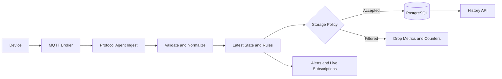
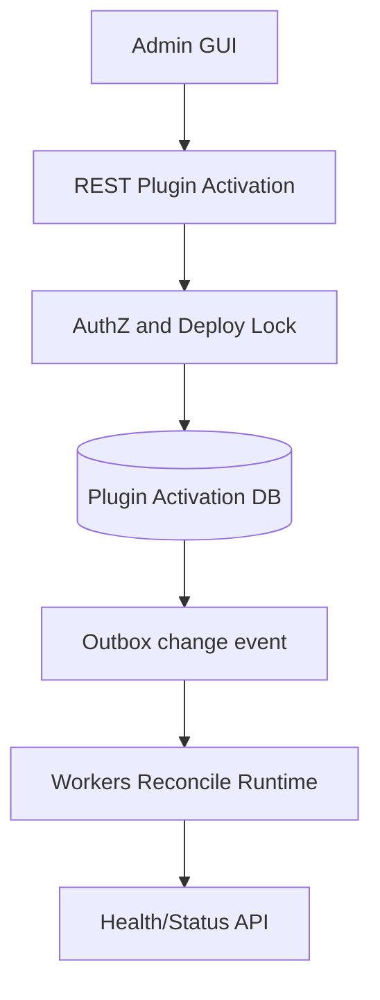
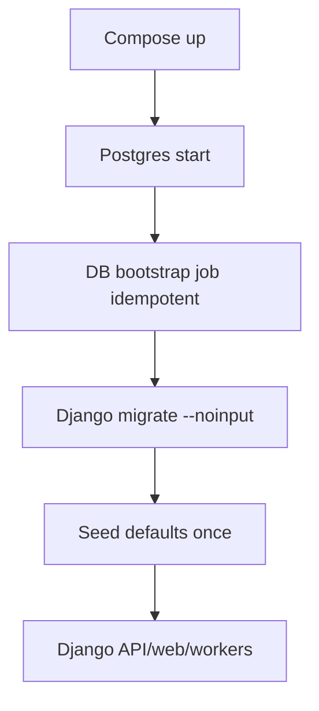

# Diagramas de flujo C4 lógico + escenarios operativos

## Flujo telemetría MQTT

La política de almacenamiento NO es filtro de eventos de reglas ni actualizaciones de estado actual. Los eventos de comandos no se silencian por cuota de históricos.

## Flujo cambio de plugin

No tocar `INSTALLED_APPS` ni reiniciar desde GUI; si no instalado, comunicar `INSTALL_REQUIRED`.

## Flujo DB primera ejecución

`db-bootstrap` valida extensiones disponibles, roles/DB, scripts y permisos, aborta explícitamente si falta PostGIS.

## Flujo import/export Node-RED
1. Export JSON o Admin API (solo entorno test/autorizado) → parser estructural → propuesta de assets/points/relations → dedupe `external_ref` → preview diff/confirm → registro canónico.
2. Asset/puntos OAP → generador de flow JSON versionado → validar topología/nombres/no secrets → preview → `POST /flow` o `PUT /flow/:id` autorizado con hash de concurrencia. Node-RED mantiene ejecución, OAP semántica/identidad.

## Flujo MCP escritura
Prompt externo → MCP auth scopes → herramienta `propose_*` → diff firmado o expirable → validación de dominio/SHACL/roles → aprobación humana → comando idempotente → auditoría y respuesta; nunca write directa DB, nunca command físico implícito.
