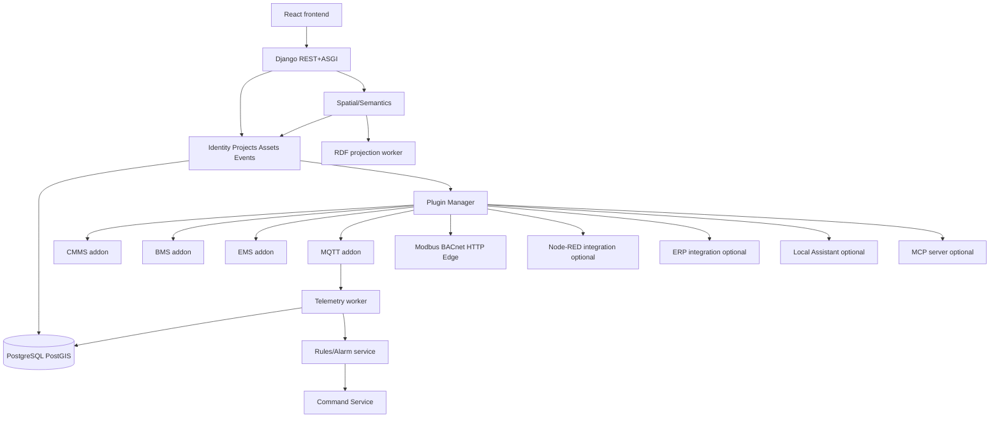

# Grafo de dependencias planificado (NO grafo extraído del código fuente)

Este esquema es arquitectura objetivo. **No debe confundirse con la extracción exigida de código OpenRemote/Atlas** (`docs/research/CODE_GRAPH_RUNBOOK.md`). El grafo real debe obtenerse tras descargar fuentes y fijar hashes con evidencia.

## Regla de dependencia
Addons dependen de interfaces `core.*` públicas; CORE jamás importa módulos de addons. `cmms` puede consumir `assets` por servicios autorizados, no consultar tablas privadas. `nodered` es optional y nunca ancestro obligatorio de MQTT ingestion. No permitir ciclos en manifest graph.
